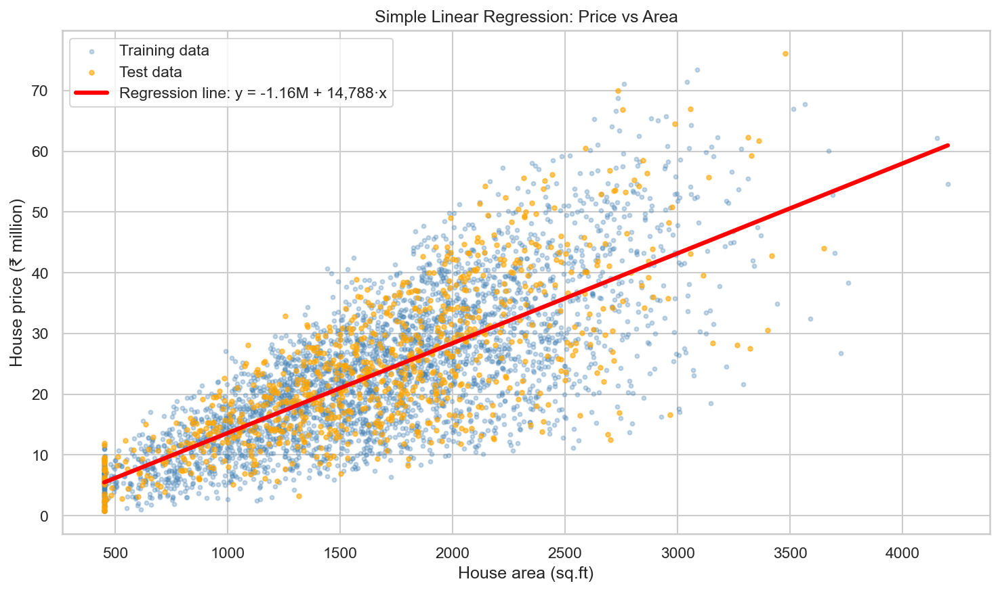
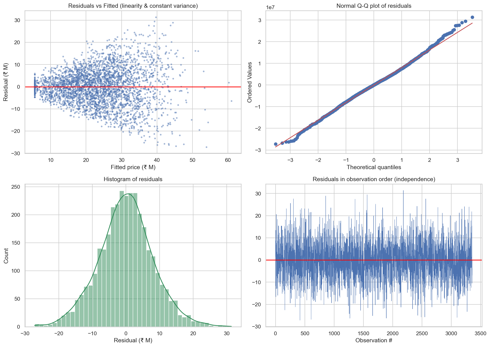
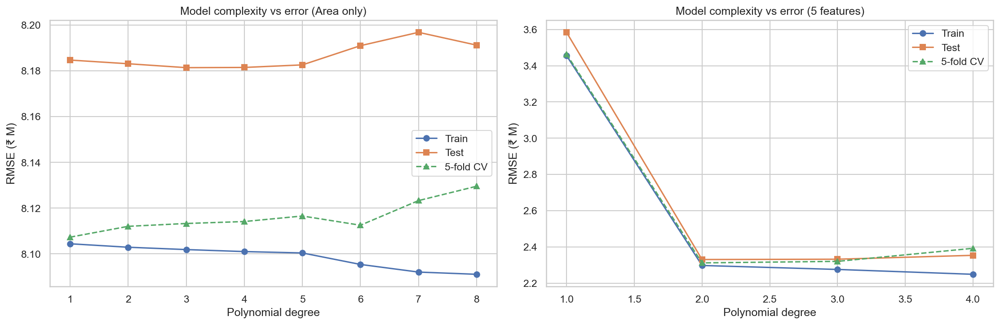
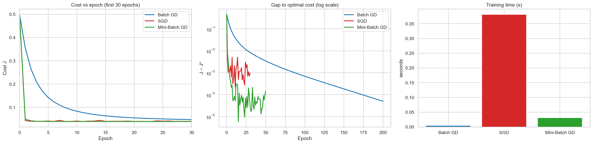
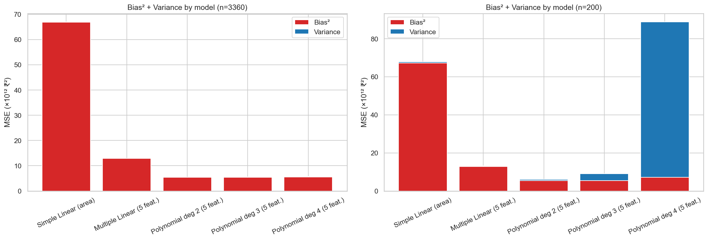
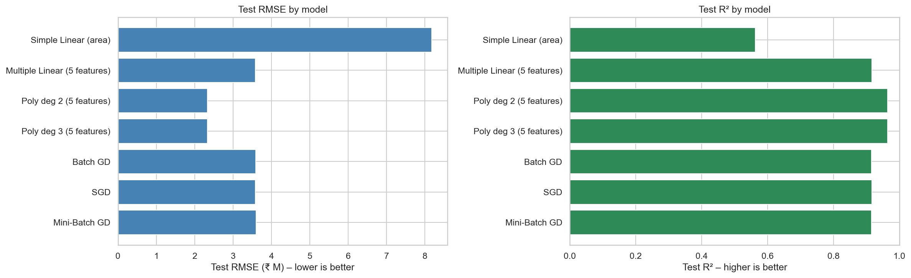

# 🏠 Predictive Insight Engine – House Price Prediction with Regression

> **Author:** Ajay Sosa

An end-to-end supervised-learning project that builds and compares **Simple, Multiple and Polynomial Linear Regression** models, optimises them with **Gradient Descent (Batch, SGD, Mini-Batch – implemented from scratch)** and explains model behaviour through the **bias–variance trade-off**, overfitting and underfitting.

## 📌 Objectives
- Understand and implement regression algorithms and evaluate them (MSE, MAE, RMSE, R², Adjusted R²).
- Validate linear-regression assumptions (linearity, independence, homoscedasticity, normality, multicollinearity).
- Implement Batch / Stochastic / Mini-Batch Gradient Descent from scratch and compare convergence and training time.
- Analyse bias and variance, detect overfitting / underfitting, and choose the best-balanced model.

## 📂 Repository structure
```
Predictive_Insight_Engine/
├── Predictive_Insight_Engine.ipynb   # full implementation (Parts A–I) with outputs and interpretations
├── data/RealEstate_HousePrice_Dataset_4200.csv
├── images/                           # 14 labelled charts / screenshots of the results
├── results/                          # evaluation tables (CSV)
├── Theory_Concepts.pdf               # theory concepts with definitions
├── Final_Report.pdf                  # short final report (Task 29)
├── video_walkthrough_script.md       # script / outline for the video explanation
├── requirements.txt
└── README.md
```

## 📊 Dataset
4,200 houses, no missing values or duplicates.

| Role | Columns |
|---|---|
| Target | `house_price_inr` |
| Core features (as specified in the brief) | `area_sqft`, `bedrooms`, `bathrooms`, `location_score`, `age_years` |
| Extra columns (used only in an extended experiment) | `distance_city_km`, `lot_size_sqft`, `has_garage`, `has_pool`, `renovation_years_ago` |
| Identifier (dropped) | `house_id` |

Split: 80 % train (3,360) / 20 % test (840), `random_state=42`.


## 🏆 Results (test set)
| Model | R² | Adj. R² | MAE (₹) | RMSE (₹) |
|---|---|---|---|---|
| Simple Linear (area) | 0.5625 | 0.5620 | 6,294,594 | 8,184,697 |
| Multiple Linear (5 features) | 0.9161 | 0.9156 | 2,641,320 | 3,584,509 |
| Poly deg 2 (5 features) | 0.9645 | 0.9637 | 1,715,219 | 2,330,106 |
| Poly deg 3 (5 features) | 0.9645 | 0.9620 | 1,717,780 | 2,331,838 |
| Batch GD | 0.9158 | 0.9153 | 2,643,293 | 3,589,914 |
| SGD | 0.9164 | 0.9159 | 2,697,499 | 3,578,545 |
| Mini-Batch GD | 0.9151 | 0.9145 | 2,645,065 | 3,606,576 |

**Best model: Polynomial Regression, degree 2, on the 5 core features** (R² = 0.965, RMSE ≈ ₹2.33 M).

### Key findings
- **Underfitting:** one feature (area) explains only ≈ 56 % of the price variance; adding polynomial terms of area alone does not help (high bias).
- **Multiple Linear Regression** lifts R² to ≈ 0.92 – location score and area are the most valuable price drivers.
- **Polynomial degree 2** captures interactions/curvature (R² ≈ 0.96); degree ≥ 3 adds variance but no test accuracy. With only 150 training rows, degree 4 overfits badly (train R² ≈ 1.00, test R² < 0).
- **Gradient descent:** Batch, SGD and Mini-Batch reach the same cost and test performance as the closed-form solution; Mini-Batch is the best speed/stability trade-off; the learning rate and feature scaling are critical.
- **Bias–variance:** bias falls and variance rises with complexity; degree-2 polynomial gives the best balance.

## 🖼️ Selected figures
| | |
|---|---|
|  |  |
|  |  |
|  |  |

## 🔗 Links
- 🎥 Video explanation: https://drive.google.com/file/d/17GluHDTIxrwK4o22h6p1VoQ0-tfY64s8/view?usp=sharing
- 📄 Theory document: [Theory_Concepts.pdf](Theory_Concepts.pdf)
- 📝 Final report: [Final_Report.pdf](Final_Report.pdf)

## 🛠️ Tech stack
Python · NumPy · pandas · Matplotlib · Seaborn · SciPy · scikit-learn · Jupyter


## 👤 Author
**Ajay Sosa** – AI / ML Engineer (aspiring)
